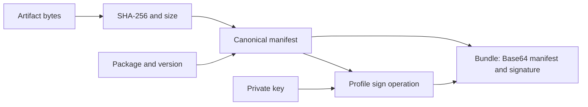
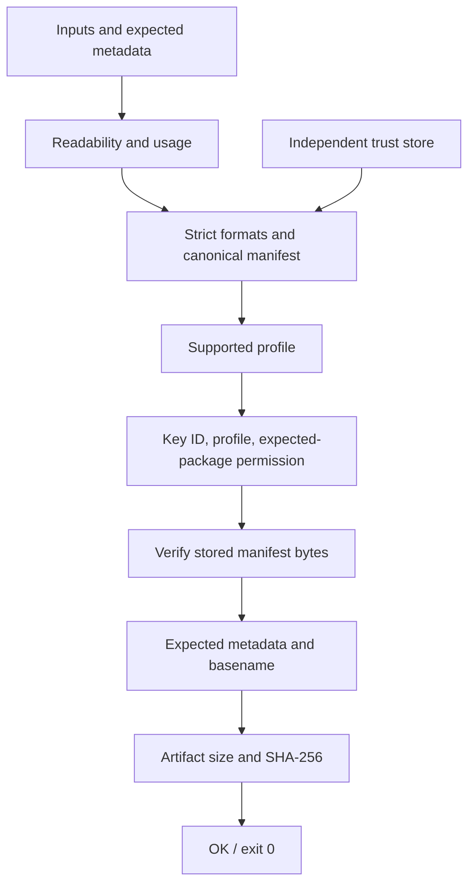
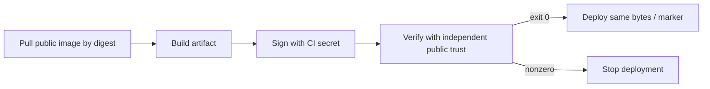

# Architecture

Every failed stage returns immediately. I/O/usage errors use exit 2; rejections
use exit 1; only `OK` sets `valid=true`. No alternative keys/profiles are tried.

The CLI handles arguments/output. Formats enforce strict JSON and encoding.
Keys validate standard envelopes and profiles; crypto selects exact signature
parameters. Trust owns explicit package permissions. Artifacts stream read-only
bytes. Signing/verifying orchestrate these modules. Storage stages/fsyncs output
and publishes by hard link or atomic replacement.

The image has an allowlisted build context and nonroot default user. Inputs and
keys mount read-only; outputs persist on the runner. Verification receives no
private key. The harness captures original exit codes and marker evidence.
Registry-pull evidence is recorded separately from local image regressions.
